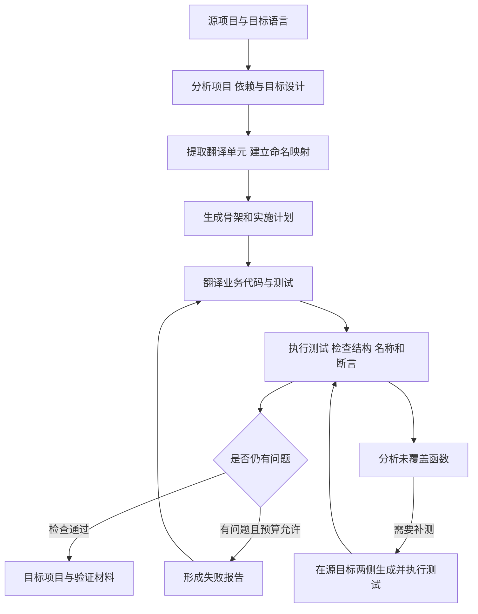

负责人：蒋逸舟。分类：参考资料研读，不计入本周两项工具完成情况。

# ReCodeAgent论文研读

研读日期：2026年10月28日。

论文：ReCodeAgent: A Multi-agent Workflow for Language-Agnostic Translation and Validation of Large-Scale Repositories。

作者：Ali Reza Ibrahimzada、Brandon Paulsen、Daniel Kroening、Reyhaneh Jabbarvand。发表于ASE 2026。本次阅读采用arXiv:2604.07341v4，2026年10月8日版本。

资料：[英文PDF](https://arxiv.org/pdf/2604.07341v4)、[论文版本页](https://arxiv.org/abs/2604.07341v4)、[官方代码仓库](https://github.com/Intelligent-CAT-Lab/ReCodeAgent)。代码核对固定在提交`3a61479e718e8464e60e5bbb8bde0368279ae42f`，避免后续仓库更新影响定位。本次完成论文阅读和关键源码的静态核对，未运行作者的完整智能体系统或重现论文统计结果。

## 一 项目在做什么

ReCodeAgent处理整个代码仓库的跨语言迁移。输入是源项目和目标语言，项目中不仅有业务代码，还有测试、构建配置和依赖；输出是翻译后的项目及分析、规划、验证等过程材料。

单独翻译一段函数时，模型面对的信息较少。换成完整项目后，类和方法分散在不同文件，测试又依赖初始化、辅助方法和库接口，容易出现名称不一致、遗漏文件、编造接口等问题。即使目标测试通过，也可能是翻译时删掉或放宽了断言。

作者将任务分为分析、规划、翻译和验证四个角色：先研究项目和依赖，再固定命名、骨架和实施顺序，随后翻译业务与测试，并依据验证结果修复。重点是组织已有大模型和工具完成工作，没有训练一个新的翻译模型。方法见论文§2—§3，PDF第3—6页。

“语言无关”指流程和工具接口尽量复用，底层仍需各语言的编译器、分析工具与测试框架。论文涉及C→Rust、Go→Rust、Java→Python和Python→JavaScript，没有直接支持Java→仓颉。

## 二 整体流程与模块衔接

分析阶段产出源项目研究、目标库分析和目标设计；规划阶段产出翻译单元清单、`name-mapping.json`、目标骨架和`implementation-plan.md`；翻译阶段填写实现；验证阶段返回具体问题，供下一轮处理。达到时间或迭代上限仍未通过时，需要保留未解决状态。

### 1 分析与规划

分析角色先取得目录和文件结构，了解数据模型、异常处理与依赖，再查找目标语言的库和表达方式。规划角色将这些结论转为具体任务，确定哪些片段需要翻译、名称怎样对应以及先做什么。

两者的区别是：分析说明项目怎样工作、目标准备怎样设计；规划说明哪些工作需要执行、按什么顺序执行。论文§3.3还要求生成脚本核对提取项，防止模型声称已经完成，却遗漏文件或方法。

### 2 翻译与反馈

翻译角色加载设计、命名映射和计划，按依赖顺序逐步填写骨架。计划分为业务代码部分和测试部分，两者由同一翻译角色处理，以保留必要上下文；验证工作另由专门角色执行。

验证失败时，通过报告传递失败位置、诊断及需要修复的内容。这样能够把“重新生成”缩小为有依据的修改，但仍需检查是否通过改变测试要求来迁就错误实现。

### 3 测试补充

现有测试没有执行到的函数可能隐藏翻译错误。作者根据函数清单和覆盖分析寻找缺口，再在源、目标两侧补充测试并运行。新增测试与原测试翻译是两类材料，评价时应分别统计。

## 三 流程与代码对应

代码结构分为运行入口、角色封装、提示模板、工具和结果分析。角色的Python文件主要负责生成提示、调用模型及处理返回结果；具体文档生成和检查任务有相当一部分由提示约束模型执行。阅读时需要同时看程序和模板。

下表链接到本次保存的固定版本源码副本，行号以该版本为准。

| 流程 | 文件与关键位置 | 输入、主要处理和输出 |
| --- | --- | --- |
| 启动项目 | [src/run.py](https://github.com/Intelligent-CAT-Lab/ReCodeAgent/blob/3a61479e718e8464e60e5bbb8bde0368279ae42f/src/run.py)，`main()`第152行、`run_agent()`第60行 | 读取YAML配置，取得语言和路径，进入对应运行流程 |
| 调度四个角色 | [recodeagent/agent.py](https://github.com/Intelligent-CAT-Lab/ReCodeAgent/blob/3a61479e718e8464e60e5bbb8bde0368279ae42f/src/agents/recodeagent/agent.py)，`run_agents()`第189行 | 依次执行分析、规划，再循环执行翻译和验证，保存`project_details.json` |
| 分析项目 | [analyzer/agent.py](https://github.com/Intelligent-CAT-Lab/ReCodeAgent/blob/3a61479e718e8464e60e5bbb8bde0368279ae42f/src/agents/recodeagent/analyzer/agent.py)，`AnalyzerAgent.run()`第44行 | 生成分析提示并调用模型，要求产出研究与目标设计材料 |
| 制订计划 | [planning/agent.py](https://github.com/Intelligent-CAT-Lab/ReCodeAgent/blob/3a61479e718e8464e60e5bbb8bde0368279ae42f/src/agents/recodeagent/planning/agent.py)，`PlanningAgent.run()`第44行 | 根据已有研究调用规划角色，生成映射、骨架与实施计划 |
| 组合角色提示 | [prompt_generator.py](https://github.com/Intelligent-CAT-Lab/ReCodeAgent/blob/3a61479e718e8464e60e5bbb8bde0368279ae42f/src/agents/recodeagent/prompt_generator.py)，`generate_prompt()`第55行 | 选择角色模板，填入源目标语言、目录和计划路径 |
| 定义具体任务 | [prompt_templates.yaml](https://github.com/Intelligent-CAT-Lab/ReCodeAgent/blob/3a61479e718e8464e60e5bbb8bde0368279ae42f/configs/prompt_templates.yaml)，`analyzer`第3行、`planning`第74行、`translator`第238行、`validator`第421行 | 规定文档、命名、填充、检查和报告要求 |
| 翻译及读取反馈 | [translator/agent.py](https://github.com/Intelligent-CAT-Lab/ReCodeAgent/blob/3a61479e718e8464e60e5bbb8bde0368279ae42f/src/agents/recodeagent/translator/agent.py)，`_get_validation_feedback()`第55行、`run()`第90行 | 读取`validation-report.md`，将失败信息附加到翻译请求 |
| 执行验证角色 | [validator/agent.py](https://github.com/Intelligent-CAT-Lab/ReCodeAgent/blob/3a61479e718e8464e60e5bbb8bde0368279ae42f/src/agents/recodeagent/validator/agent.py)，`ValidatorAgent.run()`第66行 | 调用验证提示，按约定生成问题报告或完成摘要 |
| 配置细分任务 | [generate_agent_config.py](https://github.com/Intelligent-CAT-Lab/ReCodeAgent/blob/3a61479e718e8464e60e5bbb8bde0368279ae42f/docker-env/generate_agent_config.py)，`extra_translator_agent_args`第19行、`extra_validator_agent_args`第27行 | 配置逐文件翻译、测试检查和执行等子任务，包含`test-validator`、`name-validator`等角色说明 |
| 发起模型工具会话 | [model_utils.py](https://github.com/Intelligent-CAT-Lab/ReCodeAgent/blob/3a61479e718e8464e60e5bbb8bde0368279ae42f/src/utils/model_utils.py)，`prompt_agent()`第36行；[cmd_utils.py](https://github.com/Intelligent-CAT-Lab/ReCodeAgent/blob/3a61479e718e8464e60e5bbb8bde0368279ae42f/src/utils/cmd_utils.py)，`run_claude_code()`第8行 | 调用Claude Code命令，传入提示、反馈和工具配置，收集输出 |
| 查询目录和结构 | [project_analyzer.py](https://github.com/Intelligent-CAT-Lab/ReCodeAgent/blob/3a61479e718e8464e60e5bbb8bde0368279ae42f/src/mcp/mcp_project_analyzer/project_analyzer.py)，`get_file_structure()`第1965行、`get_directory_tree()`第2012行 | 返回目录树及类、方法、字段等结构信息 |
| 查找具体定义 | [definition.go](https://github.com/Intelligent-CAT-Lab/ReCodeAgent/blob/3a61479e718e8464e60e5bbb8bde0368279ae42f/src/mcp/mcp_language_server/internal/tools/definition.go)，`ReadDefinition()`第12行 | 通过语言服务器查找符号定义，返回代码和位置 |
| 比较源目标测试 | [compare_tests.py](https://github.com/Intelligent-CAT-Lab/ReCodeAgent/blob/3a61479e718e8464e60e5bbb8bde0368279ae42f/src/analysis/compare_tests.py)，`TestComparator.compare_all_tests()`第2319行、`generate_json_report()`第2466行 | 按测试配对表解析两侧测试，生成结构和断言比较报告 |

阅读代码时，可先沿`run_agent → run_agents → 各角色run → PromptGenerator`看主流程，再看模板中要求生成的文件，最后查看测试比较脚本。这样能分清“程序直接完成了什么”和“程序要求模型去做什么”。

## 四 两个重点机制

### 1 名称和接口怎样保持一致

论文§3.3.2使用源目标名称映射，§3.3.3依据映射生成骨架。仓库的规划模板要求建立`name-mapping.json`；翻译模板要求读取映射并使用对应名称。验证配置中的`name-validator`还要求直接比较源、目标标识符。

这些约定主要防止不同文件对同一个成员采用不同名称。接口一致还需核对参数、返回值和实际调用位置；名称相同不说明行为相同。

仓库以严格保留名称为主，但翻译模板也为无法直接表达的重载保留特定适配方式。因此本项目更适合以稳定成员标识及明确映射追踪对应关系，必要改名时记录原因并同步检查引用，而非只比较字符串。

### 2 翻译前后的断言怎样核对

仓库有两条检查路径。运行流程中的`test-validator`由提示要求比较断言数量和条件；实验分析中的`compare_tests.py`则按照测试配对表计算结构指标。

| 检查内容 | 代码位置 | 能提供的证据 |
| --- | --- | --- |
| 找到测试及方法正文 | `JavaTestParser.parse_test_file()`第1265行等语言解析器 | 测试是否找到，正文、参数和断言统计是什么 |
| 读取源目标配对 | `TestComparator.load_mappings()`第2310行 | 按CSV对应比较，不自动保证配对正确 |
| 比较参数和断言数量 | `_compare_single_test()`第2370行 | 是否存在明显结构遗漏 |
| 比较断言类型和匹配 | `extract_assertion_types()`第101行、`match_assertions()`第914行 | 断言模式是否发生变化 |
| 比较相等断言字面量 | `compare_assertEquals_values()`第1124行 | 可抽取的值是否匹配，不是运行时结果验证 |
| 保存详细结果 | `generate_json_report()`第2466行 | 缺失测试、数量、类型及其他比较结果 |

入口脚本为[scripts/run_test_comparison.sh](https://github.com/Intelligent-CAT-Lab/ReCodeAgent/blob/3a61479e718e8464e60e5bbb8bde0368279ae42f/scripts/run_test_comparison.sh)。它需要已有翻译结果和`test_name_mapping.csv`，并非执行主翻译流程后就自然完成所有对照。

这些检查仍会留下语义空缺。例如，源测试检查`account.getBalance()`，译文检查了另一个账户，即使断言数量和预期100都相同，也可能改变含义。辅助方法中的断言、异常检查范围和失败后的控制流，同样需要结合上下文核查。当前脚本没有仓颉解析器，不能直接用于我们的语言方向。

## 五 用账户测试串起流程

下面将论文思路套用到已有账户例子，说明各阶段如何交接。这是本项目的说明例，不是作者实验项目，也不表示官方系统已经支持仓颉。

源测试包括：正常取款30后余额70；余额不足时取款150应抛出指定异常，随后余额仍为100。两条测试都通过setup调用createAccount，准备余额100的账户。

| 阶段 | 对该例的处理 | 交给下一阶段的内容 |
| --- | --- | --- |
| 分析 | 找到字段、准备方法、工厂及Account定义，区分两个检查要求 | 准备链、源接口和行为说明 |
| 规划 | 固定目标成员对应，登记四个待填方法及顺序 | 映射、骨架、填充清单 |
| 翻译 | 按工厂→setup→测试的关系填写原逻辑 | 候选测试与使用依据 |
| 验证 | 检查实际发现和执行数量，核对异常及状态断言 | 运行结果和具体差异 |
| 反馈 | 若工厂仍返回占位0，指出原工厂实际传入100 | 修复准备逻辑，不修改70或100求通过 |

已有本地开发例验证了工厂占位错误的影响：正常取款会在操作时意外抛异常，余额不足测试则在后续余额检查失败。这解释了准备上下文和状态断言的作用，记录见账户引导教程（本地教学材料，本参考包未附，不计入本周工具验收）。该运行是本项目的教学与开发记录，不是ReCodeAgent复现实验。

## 六 论文的实验思路与结论

论文§4按四个问题评价方法：能否有效翻译真实项目，测试翻译质量如何，各角色分别有什么贡献，以及成本和工具使用情况如何。

实验涉及118个项目、6种语言和4个语言对，主要使用Claude 4.5 Sonnet。比较对象包括AlphaTrans、Oxidizer、SKEL和Crust中的SWE-agent。作者将编译、既有测试、系统翻译测试、额外生成测试和函数级验证分开观察，并通过移除角色的消融条件分析流程设计。

| 作者报告的结果 | 指标含义 | 阅读时的边界 |
| --- | --- | --- |
| 编译成功率99.4% | 目标项目可构建情况 | 不能单独说明行为正确 |
| 经核对开发者测试通过率86.5%，1822/2107 | 给定测试对业务译文的接受情况 | 属于业务翻译评价，不是测试翻译准确率 |
| 译后测试断言数量匹配比例99.3%，1473/1484 | 源目标测试断言数量对应 | 数量相同仍可能检查了不同对象或条件 |
| 测试翻译人工调查准确率88% | 抽样复核的质量判断 | 不能扩大为全部测试、全部路径的等价保证 |

论文还比较部分相等断言的预期值、断言类型、代码向量相似度、行数及调用数。多项证据比单一通过率更有解释力，但仍未构成完整语义证明。具体数据见§4.2—§4.3，PDF第7—9页。

消融与成本分析分别对应[src/analysis/ablation.py](https://github.com/Intelligent-CAT-Lab/ReCodeAgent/blob/3a61479e718e8464e60e5bbb8bde0368279ae42f/src/analysis/ablation.py)的`main()`第606行和[cost.py](https://github.com/Intelligent-CAT-Lab/ReCodeAgent/blob/3a61479e718e8464e60e5bbb8bde0368279ae42f/src/analysis/cost.py)的`main()`第794行。它们消费已有结果和轨迹，本次未运行。

## 七 对本项目的借鉴清单

| 具体做法 | 对应环节 | 调整方式 | 适用条件与限制 |
| --- | --- | --- | --- |
| 先研究结构、依赖和目标设计 | 项目约定材料生成 | 输出接口、公共代码、版本和来源，分开记录缺失与冲突 | 具体测试输入及预期仍属于样例信息 |
| 命名映射与骨架共同约束翻译 | 项目材料与逻辑填充 | 以成员标识连接Java和仓颉接口，检查参数及可见性 | 必要适配需更新映射，名称一致不能替代行为核验 |
| 用结构与定义工具取得事实 | 上下文查找 | 先索引，再导出初始化、辅助及必要类外定义的实际代码 | 结构清单不是完整上下文；未解析项应列出 |
| 依赖优先、逐步填充 | 测试逻辑翻译 | 优先恢复准备和辅助逻辑，再填测试；保留原方法体 | 属于本项目适配，不能丢掉生命周期和共享状态 |
| 断言数量、类型和字面量比较 | 测试意图核验 | 用作预检查，再逐项核对准备、对象、参数、全部断言和流程 | 需补仓颉解析与辅助断言；结论保留待确认类别 |
| 将失败整理成报告 | 执行与反馈 | 固定记录编译、发现、执行、失败及对应源码，保留各轮版本 | 环境和材料错误单列，不靠删断言修复 |
| 按角色和条件做消融 | 后续方法对照 | 固定样例与预算，分别比较上下文补充、意图提取、反馈 | 不把多个因素同时变化的收益归给上下文 |

第七周可以先采用程序、可复用提示和人工复核的组合。对当前上下文模块，优先交付查找范围、原代码、相关片段、来源和未解析项；无需先搭建完整多智能体平台。

项目材料可以落实为`project_materials.json`和同名Markdown，记录源目标符号、完整签名、目录依赖、公共代码、来源和缺失项。测试意图核验则逐项记录Java依据、仓颉对应位置、结论和理由，结论采用“保留／改变／遗漏／待确认”。这两项是按第七周要求设计的交付形式，并非原仓库的同名功能。

项目材料与意图核验是本篇最直接的借鉴点：前者减少不同译文对同一接口的理解分歧，后者检查测试是否仍保留原要求。错误实现对照可继续作为补充证据，但不是将论文业务翻译通过率直接转成测试迁移效果。

## 八 代码阅读中需要注意的边界

第一，文件结构工具主要给出名称、类型及位置。例如`_extract_java_method()`记录方法信息，没有导出完整方法体。用于第七周上下文查找时，还需要按位置读取实际代码，并继续追踪必要依赖。

第二，提示中的要求不等于程序已经直接完成验证。角色封装中的成功返回主要说明模型调用取得结果；是否真正通过还需查看具体报告和运行证据。

第三，当前调度代码使用摘要文件存在或报告中的PASS文本作为部分终止依据；循环未收敛后仍可能走到最终成功返回。本项目应检查明确的验证状态、预期测试数量及退出码，保留未通过记录。这里是固定版本的静态代码观察，本次未用运行复现该分支。

第四，论文只在部分语言和项目上评价，且主要实验每项运行一次，还存在模型非确定性和训练数据污染等威胁。目标业务实现缺失时，也不能照用其完整执行验证条件。相关讨论见论文§6。

## 九 本次研读完成情况

已完成论文主线、流程图、模块输入输出、关键代码位置及借鉴清单的整理，并核对了官方仓库固定提交的相关文件。源码副本及校验值保存于[代码核对目录](source_manifest.json)。

未运行完整智能体流程、MCP服务、测试比较脚本或作者实验结果包；本文实验数值均来自论文，不是本次测得。此前账户例子仅用于解释方法，未被当作论文复现结果。

后续阅读或复用可以从`run_agents`和提示模板开始，再查看`compare_tests.py`。对本项目，先落实有来源的项目材料和逐项测试意图核验，再用新样例评价效果。
