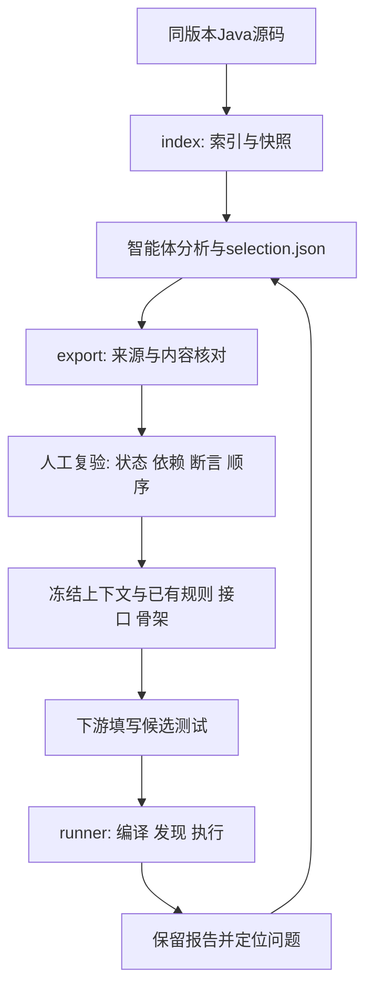

# 工具设计与输入输出

## 1. 设计分工

程序负责定位、取片段、校验与记录；智能体负责分析依赖并提出选择；人工负责影响测试含义的判断。三者通过文件交接，不要求在本地工具内再接模型API。沿用团队成员标识，避免另一套短ID与上游格式脱节。

|文件|输入|处理逻辑|输出|不承担的职责|
|---|---|---|---|---|
|context_lookup.py index|仓库根、Java测试/业务目录、输出目录、java/javac路径|编译调用已有提取器；读取members.json；保留UTF-16位置、快照、哈希与原成员标识|catalog.json、index.md、test-members/、main-members/及提取日志|不运行Java业务测试；不做完整类型绑定或自动依赖闭包|
|context_lookup.py export|catalog.json、selection.json、当前仓库与新输出目录|校验版本及符号唯一性；核对现场/快照哈希；按原始UTF-16偏移截取；冻结实际选择及输入|context_NN.json/md、inputs/、selection.json、checks.json|不判定依赖充分性、断言等价或人工审核真实性|
|evaluate_account.py|仓库根、SDK路径、运行库说明、新输出目录|固定九条参考测试清单；定位既有仓颉文件；记录编译器及runtime摘要；委托通用执行器|config.json、run_metadata.json、execution/|不生成仓颉测试；不把参考测试计为模型翻译结果|
|cangjie_runner.py|配置文件、单个/多个业务与测试组合、新输出目录|收集源码；准备SDK环境；分别编译、发现、运行；解析控制台/XML并核对预期身份与数量|每组result.json/report.md、源码副本、命令、日志、XML及汇总JSON/CSV/Markdown|不证明语义等价；当前仅验收Windows单包普通类测试|
|check_delivery.py|模块内已有索引、上下文与历史评价证据|交叉核对格式、源码关系及汇总结果|标准输出all_passed/passed/total|不重跑SDK，不替代人工内容审查|
|tests/test_context_lookup.py|临时目录中的最小源码、索引和选择|构造UTF-16定位、过期来源、歧义符号、未知依赖、覆盖与路径越界情形|7项unittest结果|不评价智能体选择质量或翻译质量|

## 2. 上下文工具的关键设计

`index_repository()`复用`JavaTestSkeletonExtractor.java`，分别处理test/main根目录。`catalog.json`在原结构上增加分组与可追溯内容，不把同名字符串自动认作同一方法。`source_text()`按Java的UTF-16单位切片，避免中文、emoji和换行导致偏移错位。

`export_context()`先构造`(group, symbol)`查找表，遇到歧义即拒绝；随后核对全部索引文件的现场和快照摘要。每个目标必须是普通`@Test`，每条evidence必须有非空理由；导出包含目标方法、完整所在类以及显式选择的依赖。`checks.json`的`checked_entries`按“2＋evidence数”统计，不表示独立调用链数量。

完整类用于复核准备、辅助方法和断言，因此可能带入未显式选中的其他方法。这是可读性与最小输入之间的取舍。当前导出不是严格最小上下文包；后续比较上下文策略时应冻结实际输入，不能只比较evidence长度。

当前没有自动解析调用图。`reason`、`use`、`unresolved`记录的是选择说明，不是解析器证明；字段合法性和输出来源一致也不保证依赖充分。详见[人工复验规范](selection人工复验规范.md)。

## 3. 执行评价的关键设计

`evaluate_account.py`是仓库适配层，`cangjie_runner.py`是通用执行层：前者决定本例用哪些文件、预期哪些方法，后者负责各阶段执行与结果解释。更换样例时修改配置，不应通过更改执行器的判定条件迁就结果。

`process()`逐阶段保存参数、工作目录、退出状态、耗时及stdout/stderr；超时与启动异常保留独立记录。`discover()`解析发现清单；`console_counts()`检查计数守恒；`xml_results()`补足测试身份及状态；`expected_set()`将预期名称与实际清单匹配。解析不完整时保留未知或错误，不填成零。

输入路径从配置文件所在目录解析；业务输入排除`_test.cj`，配置须避免业务与测试重叠。命名清单比仅给`expected_count`更能识别漏跑和错跑。即使退出码为0，也须检查是否零执行、跳过、漏项及数量不符。具体字段见[输出格式](评价输出格式说明.md)。

## 4. 文件交接关系

图中“下游填写候选测试”为交接环节，不是本工具自动实现的功能。生成失败、来源过期、依赖不明、编译失败与断言失败分别定位，不能统一归为翻译错误；每轮使用新目录保留首次输入与结果。

[逻辑串联](流程逻辑与材料衔接.md) · [操作教程](使用教程.md)
