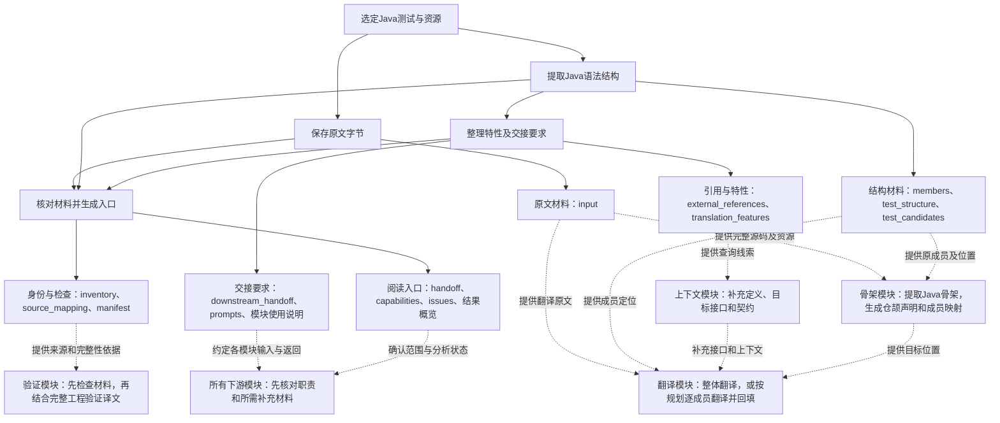

# 测试代码预处理工具

为Java→仓颉测试代码翻译保存测试与资源原文，提取语法结构、成员、引用及特性提示，生成下游交接材料。

## 整体思维导图

实线表示工具中的处理和导出，虚线表示材料交给下游使用。下游工作由各模块执行者组织。



原文材料回答“翻译什么”；结构材料回答“代码在哪、有哪些成员”；引用与特性回答“还要确认什么”；交接要求回答“交给谁、需要补什么”；身份与检查用于核对材料来源和完整性。

## 从哪里开始读程序

先读[程序文件阅读说明](说明文档/程序文件阅读说明.md)，再沿下列顺序阅读源码：

```text
preprocess.py             整次分析如何执行
 → tools/JavaFacts.java   Java结构和位置从哪里来
 → analysis_reports.py    如何整理成报告和交接清单
 → gui.py                 窗口怎样调用共同流程
 → desktop_workflow.py    环境、目录和设置怎样检查
 → check_handoff.py       结果交出前怎样核对
```

启动脚本打开窗口，窗口调用prepare执行分析，结果采用统一的文件格式。

## 文件结构

```text
预处理工具/
├── README.md
├── 启动预处理.cmd
├── launch.ps1
├── 主体/
│   ├── src/         分析、窗口及材料检查
│   ├── config/      运行配置
│   ├── prompts/     模块提示词
│   └── scripts/     启动辅助
├── 说明文档/
│   ├── 使用说明.md
│   ├── 输出文件与字段使用说明.md
│   ├── 下游模块使用说明.md
│   └── 程序文件阅读说明.md
└── 样例/
    ├── README.md
    ├── 运行记录.txt
    └── 结果/        一次实际预处理输出，input内包含样例源码
```

## 使用

准备Python 3.10以上、Tkinter和完整JDK 17以上。Windows双击启动预处理.cmd，选择“使用随包样例”，检查环境后开始分析。选择工程之外的结果保存位置；默认保存在工具根目录下的新轮次目录。

## 保存与载入配置

在窗口中选择工程、测试及资源目录和结果保存位置后，点击“保存设置”生成.json文件。下次点击“载入设置”，选中该文件，核对后开始分析。


## 处理范围

工具对所选测试执行原字节复制与Java语法解析。注解名称和调用表达式作为下游确认的线索；目标接口、骨架生成与测试执行由对应模块承担。

操作见[使用说明](说明文档/使用说明.md)，字段见[输出文件与字段使用说明](说明文档/输出文件与字段使用说明.md)，模块交接见[下游模块使用说明](说明文档/下游模块使用说明.md)，实际样例见[样例说明](样例/README.md)。
