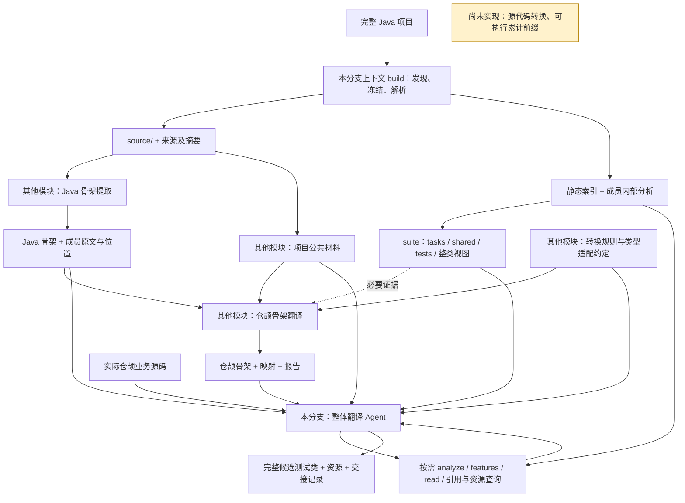

# 职责分工与流程

本文解释各部分如何衔接，以及原先讨论的预处理职责如何分配。整体程序调用说明见 [使用说明](README.md)，执行约束见 [整体提示词](整体翻译/translate_whole.md)。

## 预处理职责的去向

| 工作 | 现在由谁负责 | 当前状态 |
| --- | --- | --- |
| 项目发现、业务/测试/辅助/资源分类 | 上下文 scan_project、layout | 已实现 |
| 同版源码、来源、目录、摘要和任务范围 | 上下文 source/、source_manifest | 已实现，保留原字节 |
| 类型、成员、注解、初始化和静态引用 | 上下文解析与索引 | 已实现基础事实和静态声明证据，保留未解析 |
| 测试内部语句/检查位置/控制区域 | 上下文 internal_analysis | 已实现只读结构分析 |
| Java 声明骨架和源成员表 | Java 骨架提取模块 | 沿用其实际程序/交付，本工具不重复生成 |
| 仓颉骨架、类型表示与目标调用约定 | 骨架翻译、转换规则、公共材料等对应模块 | 对接已有结果，由对应模块处理 |
| 完整测试类理解和翻译 | 当前整体 Agent | 依据材料、查询和目标源码完成 |
| AlphaTrans 式源程序改写转换 | 尚无实现 | 不消除重载、不改造构造器、不改写调用点 |

预处理职责已分到上下文、骨架和类型适配等模块，因此取消独立入口。上下文提取 Java 类型事实，类型翻译由对应模块处理；源代码转换当前不支持。

## 调用流程

不要求骨架、公共材料先生成才能建索引；其他模块也可以使用同版原源码，已有产物按摘要核对即可。共享上下文不替代公共材料，Java 索引不替代仓颉业务接口证据。

## 尚未实现的部分

- **源代码转换**：没有源侧重命名、构造器重构及调用点同步改写，也没有改写后的源测试等价检查。
- **可执行测试累计前缀**：没有按测试内部切点生成、编译和执行新测试；没有前缀失败定位、跳过后续前缀或据反馈自动修复。
- **完整运行时控制流和动态依赖**：静态声明不确定多态实际实现；反射、动态加载、运行环境和动态资源仍可能未知。
- **自动语义因果分析**：程序不证明某个操作导致某个断言结果，不将源码顺序直接当执行轨迹。
- **全面框架支持**：自定义断言、参数源、扩展、嵌套实例、mock 和动态测试等仍需 Agent 结合真实材料判断。
- **自动跨语言等价证明**：上下文没有自动确认 Java 与仓颉所有输入行为等价。

目前“一条测试一份上下文”不等于“把该测试拆成多个前缀测试”。内部语句/控制区域分析是只读材料组织，原测试方法及数量不变。
